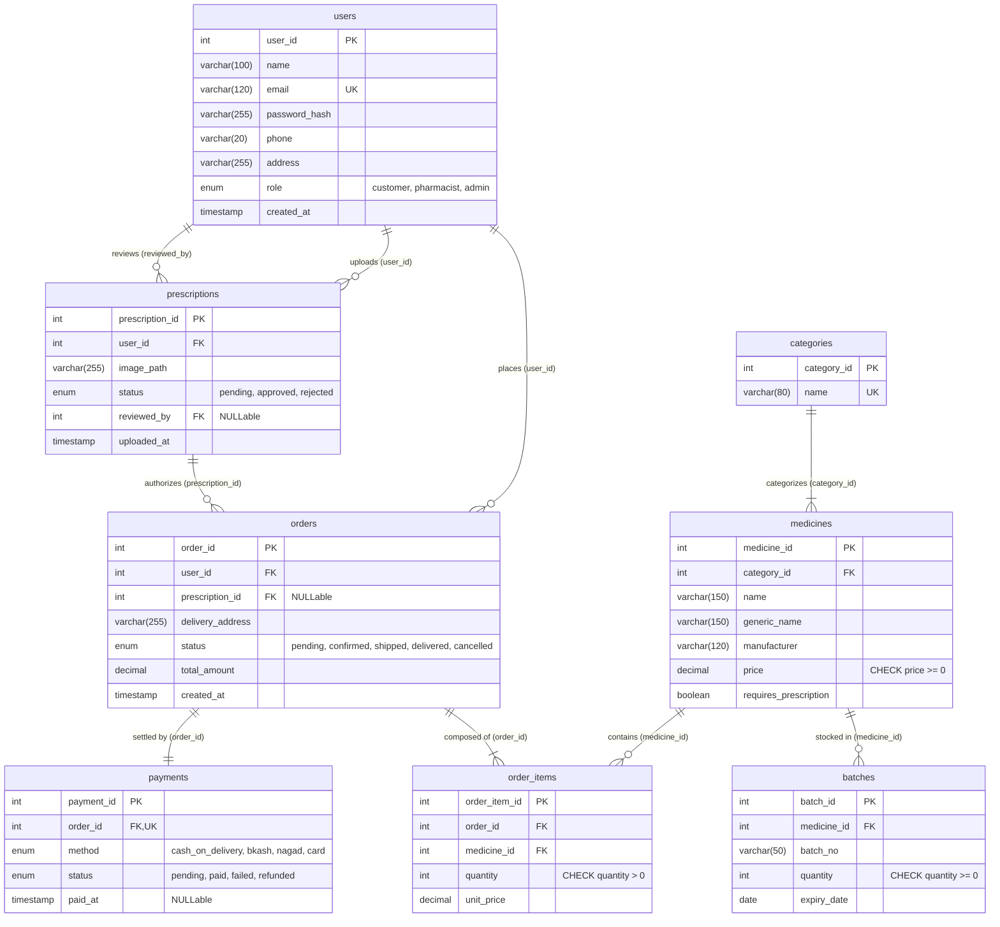

# Entity Relationship Diagram (ERD) - Pharmacy Management Web System

This document outlines the database architecture and entity relationships for the Pharmacy Management Backend System. The database consists of **exactly 8 tables**, strictly normalized without any extraneous entities.

---

## 1. Mermaid Entity-Relationship Diagram

---

## 2. Table Specifications and Schema Details

### 1. `users`
Represents registered system actors. Roles are consolidated into an ENUM column (`customer`, `pharmacist`, `admin`) to eliminate unnecessary join tables.
- `user_id` (INT, PK, Auto Increment)
- `name` (VARCHAR(100), NOT NULL)
- `email` (VARCHAR(120), UNIQUE, NOT NULL)
- `password_hash` (VARCHAR(255), NOT NULL, bcrypt)
- `phone` (VARCHAR(20), NULLable)
- `address` (VARCHAR(255), NULLable)
- `role` (ENUM('customer','pharmacist','admin'), DEFAULT 'customer')
- `created_at` (TIMESTAMP, DEFAULT CURRENT_TIMESTAMP)

### 2. `categories`
Product classifications for pharmaceutical drugs.
- `category_id` (INT, PK, Auto Increment)
- `name` (VARCHAR(80), UNIQUE, NOT NULL)

### 3. `medicines`
Drug catalog containing pricing, generic names, manufacturer details, and prescription requirements.
- `medicine_id` (INT, PK, Auto Increment)
- `category_id` (INT, FK -> categories.category_id)
- `name` (VARCHAR(150), NOT NULL)
- `generic_name` (VARCHAR(150), NULLable)
- `manufacturer` (VARCHAR(120), NULLable)
- `price` (DECIMAL(10,2), CHECK price >= 0)
- `requires_prescription` (BOOLEAN, DEFAULT FALSE)

### 4. `batches`
Physical inventory lot allocations, tracking expiry dates and stock levels for First Expiry, First Out (FEFO) dispensing.
- `batch_id` (INT, PK, Auto Increment)
- `medicine_id` (INT, FK -> medicines.medicine_id)
- `batch_no` (VARCHAR(50), NOT NULL)
- `quantity` (INT, CHECK quantity >= 0)
- `expiry_date` (DATE, NOT NULL)

### 5. `prescriptions`
Uploaded medical prescription scans for customer orders requiring physician authorization.
- `prescription_id` (INT, PK, Auto Increment)
- `user_id` (INT, FK -> users.user_id) - customer who uploaded
- `image_path` (VARCHAR(255), NOT NULL)
- `status` (ENUM('pending','approved','rejected'), DEFAULT 'pending')
- `reviewed_by` (INT, FK -> users.user_id, NULLable) - pharmacist who reviewed
- `uploaded_at` (TIMESTAMP, DEFAULT CURRENT_TIMESTAMP)

### 6. `orders`
Purchase orders created by customers with transactional delivery and status tracking.
- `order_id` (INT, PK, Auto Increment)
- `user_id` (INT, FK -> users.user_id)
- `prescription_id` (INT, FK -> prescriptions.prescription_id, NULLable)
- `delivery_address` (VARCHAR(255), NOT NULL)
- `status` (ENUM('pending','confirmed','shipped','delivered','cancelled'), DEFAULT 'pending')
- `total_amount` (DECIMAL(10,2), NOT NULL)
- `created_at` (TIMESTAMP, DEFAULT CURRENT_TIMESTAMP)

### 7. `order_items`
Individual line items in an order, preserving historical unit price at time of purchase.
- `order_item_id` (INT, PK, Auto Increment)
- `order_id` (INT, FK -> orders.order_id ON DELETE CASCADE)
- `medicine_id` (INT, FK -> medicines.medicine_id)
- `quantity` (INT, CHECK quantity > 0)
- `unit_price` (DECIMAL(10,2), NOT NULL)

### 8. `payments`
1:1 payment audit records managing transaction channels and settlement timestamps.
- `payment_id` (INT, PK, Auto Increment)
- `order_id` (INT, FK -> orders.order_id, UNIQUE)
- `method` (ENUM('cash_on_delivery','bkash','nagad','card'), NOT NULL)
- `status` (ENUM('pending','paid','failed','refunded'), DEFAULT 'pending')
- `paid_at` (TIMESTAMP, NULLable)

---

## 3. Relational Mapping & Integrity Rules

1. **Category to Medicines (1 : N)**: One category contains many medicines. Deleting a category with active medicines returns HTTP 409 Conflict.
2. **Medicine to Batches (1 : N)**: One medicine can have multiple supply batches with varying expiry dates.
3. **User to Prescriptions (1 : N)**: Customers upload multiple prescriptions; Pharmacists review multiple prescriptions.
4. **User to Orders (1 : N)**: Customers place orders. Customers can only view and cancel their own orders.
5. **Prescription to Orders (1 : N)**: Approved prescriptions authorize one or more orders containing prescription drugs.
6. **Order to Order Items (1 : N)**: Orders contain multiple medicine line items.
7. **Order to Payment (1 : 1)**: Strict 1-to-1 relationship enforced by UNIQUE key on `order_id` in `payments`.

