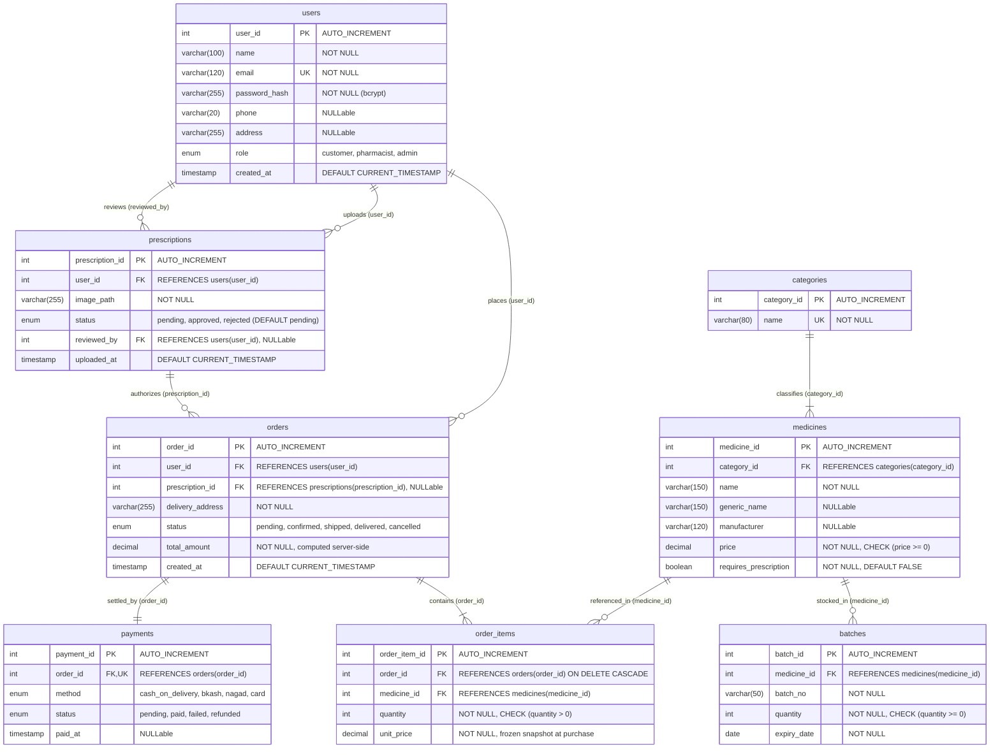

# Entity Relationship Diagram (ERD) & Database Specification
## Pharmacy Management Web System (Backend API)

---

### Executive Architecture Overview

The database architecture for the Pharmacy Management System is engineered for high-concurrency e-commerce operations, regulatory compliance for controlled pharmaceuticals, and strict transactional integrity.

The system is normalized to 3NF (Third Normal Form) and implemented with **exactly 8 core relational tables** in MySQL 8.0:
1. `users` — System actors (Customers, Pharmacists, Admins)
2. `categories` — Medicine therapeutic classifications
3. `medicines` — Drug catalog with prescription indicators
4. `batches` — Physical stock lots tracking expiration dates for FEFO dispensing
5. `prescriptions` — Customer medical prescription uploads and pharmacist audit records
6. `orders` — Customer purchase orders and delivery metadata
7. `order_items` — Immutable order line items capturing point-in-time pricing
8. `payments` — 1:1 transaction records across multi-channel gateways

---

## 1. Visual Entity Relationship Diagram (Mermaid)



---

## 2. Comprehensive Data Dictionary (All 8 Tables)

### 2.1 `users`
Stores all user accounts. Role-based access control (RBAC) is consolidated into an `ENUM` column, eliminating redundant role join tables.

| Column | Data Type | Nullable | Key / Default | Constraints & Description |
| :--- | :--- | :---: | :---: | :--- |
| `user_id` | INT | NO | **PK** (AI) | Primary unique user identifier |
| `name` | VARCHAR(100) | NO | None | Full legal or display name |
| `email` | VARCHAR(120) | NO | **UK** | Unique user email (login identifier) |
| `password_hash` | VARCHAR(255) | NO | None | 60-char bcrypt hashed secret (cost factor 10+) |
| `phone` | VARCHAR(20) | YES | NULL | Contact phone number for delivery communication |
| `address` | VARCHAR(255) | YES | NULL | Default billing/shipping address line |
| `role` | ENUM | NO | `'customer'` | `'customer'`, `'pharmacist'`, `'admin'` |
| `created_at` | TIMESTAMP | NO | `CURRENT_TIMESTAMP` | Account registration timestamp |

---

### 2.2 `categories`
Therapeutic classifications for medicines (e.g., Antibiotics, Analgesics, Cardiovascular, Vitamins).

| Column | Data Type | Nullable | Key / Default | Constraints & Description |
| :--- | :--- | :---: | :---: | :--- |
| `category_id` | INT | NO | **PK** (AI) | Primary unique category identifier |
| `name` | VARCHAR(80) | NO | **UK** | Unique therapeutic category name |

---

### 2.3 `medicines`
Drug catalog containing item names, active ingredients, manufacturer branding, price, and regulatory status.

| Column | Data Type | Nullable | Key / Default | Constraints & Description |
| :--- | :--- | :---: | :---: | :--- |
| `medicine_id` | INT | NO | **PK** (AI) | Primary unique medicine identifier |
| `category_id` | INT | NO | **FK** | Foreign key references `categories(category_id)` |
| `name` | VARCHAR(150) | NO | None | Commercial brand name (e.g., "Napa Extra 500mg") |
| `generic_name` | VARCHAR(150) | YES | NULL | Active pharmaceutical ingredient (e.g., "Paracetamol + Caffeine") |
| `manufacturer` | VARCHAR(120) | YES | NULL | Manufacturing laboratory (e.g., "Beximco Pharma") |
| `price` | DECIMAL(10,2)| NO | None | Unit price in local currency (`CHECK (price >= 0)`) |
| `requires_prescription` | BOOLEAN | NO | `FALSE` | Flag requiring validated Rx to purchase |

---

### 2.4 `batches`
Physical inventory lot allocations. Tracks expiration dates and stock quantities to enforce FEFO dispensing.

| Column | Data Type | Nullable | Key / Default | Constraints & Description |
| :--- | :--- | :---: | :---: | :--- |
| `batch_id` | INT | NO | **PK** (AI) | Primary unique inventory batch identifier |
| `medicine_id` | INT | NO | **FK** | Foreign key references `medicines(medicine_id)` |
| `batch_no` | VARCHAR(50) | NO | None | Manufacturer batch number identifier (e.g., `LOT-NP-2024A`) |
| `quantity` | INT | NO | None | Units available in batch (`CHECK (quantity >= 0)`) |
| `expiry_date` | DATE | NO | None | Shelf life expiration date |

---

### 2.5 `prescriptions`
Prescription scans uploaded by customers and reviewed by certified pharmacists or admins.

| Column | Data Type | Nullable | Key / Default | Constraints & Description |
| :--- | :--- | :---: | :---: | :--- |
| `prescription_id` | INT | NO | **PK** (AI) | Primary unique prescription identifier |
| `user_id` | INT | NO | **FK** | Uploader customer reference `users(user_id)` |
| `image_path` | VARCHAR(255) | NO | None | Relative disk path or URI (`/uploads/...`) |
| `status` | ENUM | NO | `'pending'` | `'pending'`, `'approved'`, `'rejected'` |
| `reviewed_by` | INT | YES | NULL | Pharmacist auditor reference `users(user_id)` |
| `uploaded_at` | TIMESTAMP | NO | `CURRENT_TIMESTAMP` | Upload creation timestamp |

---

### 2.6 `orders`
Master customer purchase transactions.

| Column | Data Type | Nullable | Key / Default | Constraints & Description |
| :--- | :--- | :---: | :---: | :--- |
| `order_id` | INT | NO | **PK** (AI) | Primary unique order identifier |
| `user_id` | INT | NO | **FK** | Customer purchaser reference `users(user_id)` |
| `prescription_id` | INT | YES | NULL | Required if order contains Rx drugs (`prescriptions(prescription_id)`) |
| `delivery_address`| VARCHAR(255) | NO | None | Destination shipping address for dispatch |
| `status` | ENUM | NO | `'pending'` | `'pending'`, `'confirmed'`, `'shipped'`, `'delivered'`, `'cancelled'` |
| `total_amount` | DECIMAL(10,2)| NO | None | Calculated server-side `SUM(quantity * unit_price)` |
| `created_at` | TIMESTAMP | NO | `CURRENT_TIMESTAMP` | Order placement timestamp |

---

### 2.7 `order_items`
Individual line items comprising an order. Captures the point-in-time price of each drug when ordered.

| Column | Data Type | Nullable | Key / Default | Constraints & Description |
| :--- | :--- | :---: | :---: | :--- |
| `order_item_id` | INT | NO | **PK** (AI) | Primary unique order item identifier |
| `order_id` | INT | NO | **FK** | Cascading parent reference `orders(order_id) ON DELETE CASCADE` |
| `medicine_id` | INT | NO | **FK** | Foreign key references `medicines(medicine_id)` |
| `quantity` | INT | NO | None | Number of units purchased (`CHECK (quantity > 0)`) |
| `unit_price` | DECIMAL(10,2)| NO | None | Locked historical unit price from `medicines.price` |

---

### 2.8 `payments`
One-to-one financial settlement ledger. Enforces single-settlement per order.

| Column | Data Type | Nullable | Key / Default | Constraints & Description |
| :--- | :--- | :---: | :---: | :--- |
| `payment_id` | INT | NO | **PK** (AI) | Primary unique payment identifier |
| `order_id` | INT | NO | **FK, UK** | Unique 1:1 foreign key references `orders(order_id)` |
| `method` | ENUM | NO | None | `'cash_on_delivery'`, `'bkash'`, `'nagad'`, `'card'` |
| `status` | ENUM | NO | `'pending'` | `'pending'`, `'paid'`, `'failed'`, `'refunded'` |
| `paid_at` | TIMESTAMP | YES | NULL | Settlement timestamp when transaction completes |

---

## 3. Cardinality & Relational Matrix

| Parent Entity | Relationship | Child Entity | Cardinality | Foreign Key Column | On Delete Action | Business Rule & Semantic Context |
| :--- | :---: | :--- | :---: | :--- | :--- | :--- |
| **`categories`** | 1 : N | **`medicines`** | One-to-Many | `medicines.category_id` | RESTRICT / NO ACTION | Deleting a category with associated medicines returns **HTTP 409 Conflict**. |
| **`medicines`** | 1 : N | **`batches`** | One-to-Many | `batches.medicine_id` | RESTRICT / NO ACTION | Stock is divided across multiple physical batches for FEFO tracking. |
| **`medicines`** | 1 : N | **`order_items`**| One-to-Many | `order_items.medicine_id` | RESTRICT / NO ACTION | Deleting a medicine with order history returns **HTTP 409 Conflict**. |
| **`users`** | 1 : N | **`prescriptions`**| One-to-Many | `prescriptions.user_id` | RESTRICT / NO ACTION | Customers upload multiple prescriptions; can view their own Rx records. |
| **`users`** | 1 : N | **`prescriptions`**| One-to-Many | `prescriptions.reviewed_by` | SET NULL / NO ACTION | Pharmacists and Admins audit customer prescriptions (`approved` or `rejected`). |
| **`users`** | 1 : N | **`orders`** | One-to-Many | `orders.user_id` | RESTRICT / NO ACTION | Customer places orders; ownership checks prevent cross-user access. |
| **`prescriptions`**| 1 : N | **`orders`** | One-to-Many | `orders.prescription_id` | RESTRICT / NO ACTION | An approved prescription can authorize one or more orders. |
| **`orders`** | 1 : N | **`order_items`**| One-to-Many | `order_items.order_id` | **CASCADE** | If an unfulfilled order is purged, its line items cascade delete. |
| **`orders`** | 1 : 1 | **`payments`** | One-to-One | `payments.order_id` | RESTRICT / NO ACTION | Exactly 1 payment record per order, enforced by `order_id UNIQUE`. |

---

## 4. Key Business Invariants & Transaction Engine

### 4.1 FEFO (First Expiry, First Out) Inventory Deduction
When an order is placed, stock is deducted atomically across non-expired batches using pessimistic row locking:
```sql
SELECT batch_id, quantity, expiry_date 
FROM batches 
WHERE medicine_id = ? AND expiry_date >= CURDATE() AND quantity > 0
ORDER BY expiry_date ASC 
FOR UPDATE;
```
- Only batches with `expiry_date >= CURDATE()` are eligible.
- Batches expiring earliest are depleted first.
- If total non-expired stock across all batches is less than the requested quantity, the entire transaction rolls back with **HTTP 400 Bad Request**.

### 4.2 Prescription Validation Gate
If any medicine in the incoming cart has `requires_prescription = TRUE`:
1. The request payload must include a valid `prescription_id`.
2. The prescription must belong to the authenticated user: `WHERE prescription_id = ? AND user_id = ?`.
3. The prescription status must be `'approved'`.
4. If invalid, the transaction terminates with **HTTP 403 Forbidden**.

### 4.3 Atomic Order Placement Transaction
Every order creation executes inside a single ACID MySQL transaction:
```text
BEGIN TRANSACTION;
  1. Insert into orders (user_id, delivery_address, total_amount, status='pending');
  2. For each item:
     - Verify medicine existence and copy official unit_price.
     - Execute FEFO batch allocation with SELECT ... FOR UPDATE.
     - Deduct batch quantities (UPDATE batches SET quantity = quantity - ?).
     - Insert into order_items (order_id, medicine_id, quantity, unit_price).
  3. Insert into payments (order_id, method, status='pending');
COMMIT;
-- On ANY error: ROLLBACK; release connection in finally block.
```

### 4.4 Order Cancellation Stock Restoration
When an order in `'pending'` or `'confirmed'` status is cancelled:
1. `orders.status` is updated to `'cancelled'`.
2. Each item in `order_items` is queried.
3. Quantities are restored to the medicine's latest non-expired batch.
4. Orders in `'shipped'` or `'delivered'` status cannot be cancelled (**HTTP 400 Bad Request**).

### 4.5 Single Settlement Payment Rule
- `payments.order_id` is declared `UNIQUE`.
- A payment record can only transition to `'paid'` once (`paid_at = NOW()`).
- Attempting to pay an already settled order returns **HTTP 400 Bad Request**.

---

## 5. Production Performance Indexes

The schema includes targeted composite and covering indexes for sub-millisecond query execution under load:

```sql
-- 1. Accelerates category filter & medicine search
CREATE INDEX idx_medicines_category ON medicines (category_id);
CREATE INDEX idx_medicines_name ON medicines (name);

-- 2. Optimizes FEFO inventory lookup & locking queries
CREATE INDEX idx_batches_fefo ON batches (medicine_id, expiry_date, quantity);

-- 3. Optimizes customer dashboard order lookups & order history pagination
CREATE INDEX idx_orders_user_status ON orders (user_id, status);

-- 4. Accelerates order detail joins and line item lookups
CREATE INDEX idx_order_items_order ON order_items (order_id);

-- 5. Accelerates pharmacist pending prescription queues
CREATE INDEX idx_prescriptions_user_status ON prescriptions (user_id, status);

-- 6. Optimizes financial settlement queries and payment audits
CREATE INDEX idx_payments_status ON payments (status);
```

---

## 6. Schema Verification

To initialize or verify the exact 8-table database structure:

```bash
# Execute schema migration and seed data
npm run db:init

# Verify database health via API (returns table count = 8)
curl http://localhost:5000/api/health
```

Expected `/api/health` response:
```json
{
  "success": true,
  "status": "UP",
  "tableCount": 8,
  "database": {
    "status": "connected",
    "tableCount": 8,
    "expectedCount": 8,
    "validSchema": true
  }
}
```
